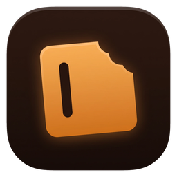

<p align="center">
  
</p>

<h1 align="center">fudge</h1>

A fast, private keyboard launcher for Linux and macOS. Press Alt+Space, type, get the answer.

Fudge is free and open source under MIT or Apache-2.0. It has no account, no telemetry and no licence key.

**Status: pre-alpha.** The core works on Linux (X11, tested on GNOME). Wayland is not finished and macOS is untested. Linux x86_64 builds are on the [Releases](https://github.com/mxskeen/fudge/releases) page.

## What it does

| Type | Result |
|---|---|
| `fire` | Launch Firefox |
| `budget` | Find files by name |
| `12 * 18` | `= 216` |
| `72 f to c` | `= 22.222222 °C` |
| `12 usd to inr` | Currency conversion (the only feature that uses the network) |
| `time tokyo` | Time in another city |
| `emoji shrug` | Copy an emoji |
| `#3b82f6` | Colour preview and conversions |
| `kill spotify`, `kill port 3000` | End a process or whatever holds a port |
| `lock`, `sleep`, `restart` | System commands (destructive ones ask first) |
| `win code` | Switch to a window |
| `/yt lofi`, `/gh rust` | Web search, only when you ask |
| `> htop` | Run a shell command |

## Install

Download the latest build from [Releases](https://github.com/mxskeen/fudge/releases). Linux x86_64 and macOS Apple Silicon (untested).

```sh
# Debian, Ubuntu and derivatives (24.04 or newer)
sudo apt install ./fudge_*_amd64.deb
fudge daemon
```

Other Linux distributions: unpack `fudge-*-linux-x86_64.tar.gz` and run `./install.sh`, which installs to `~/.local`. Press Alt+Space to open the launcher. Run `fudge install-autostart` to start it at login.

macOS (Apple Silicon, **untested**): the build compiles and the query engine runs in CI, but the launcher window, hotkey and window switching have not been tried on a real Mac. Try it and [open an issue](https://github.com/mxskeen/fudge/issues) with what you find.

```sh
brew install gtk4 libadwaita
tar xzf fudge-*-macos-arm64.tar.gz && cd fudge-*-macos-arm64 && ./install.sh
fudge daemon
```

## Build from source

Requires Rust 1.80 or newer.

```sh
# Debian / Ubuntu
sudo apt install build-essential pkg-config libgtk-4-dev libadwaita-1-dev \
  libsqlite3-dev libx11-dev libxcb1-dev

cargo build --release
./target/release/fudge daemon
```

On macOS, install `gtk4`, `libadwaita` and `pkg-config` with Homebrew. It builds in CI but has not been tested on a real Mac.

## Use

```sh
fudge daemon              # start the resident launcher
fudge toggle              # show or hide it
fudge query "72 f to c"   # run a query without the UI (add --json for JSON)
fudge install-autostart   # start on login
fudge install-shortcut    # bind Alt+Space on GNOME
```

On X11, Alt+Space is grabbed directly. On Wayland there is no global grab yet: bind `fudge toggle` to a key in your desktop settings.

## Layout

| Path | Purpose |
|---|---|
| `crates/fudge-compute` | Math, units, currency, time zones, emoji, colour. No I/O; also builds to WebAssembly |
| `crates/fudge-core` | Query, result and action types, ranking, history, config |
| `crates/fudge-platform` | Linux and macOS system glue |
| `crates/fudge-providers` | Apps, files, windows, kill, system, web search, shell |
| `apps/fudge` | GTK4 window, daemon and CLI |
| `web` | Project website (Astro) |

Run the tests with `cargo test --workspace`.

## Privacy

Nothing you type leaves your machine. The only network call is the currency rate lookup, at most once an hour, and it can be turned off. Every call is listed in [PRIVACY.md](PRIVACY.md).

## Roadmap

See [docs/PLAN.md](docs/PLAN.md). Planned next: Wayland window switching, a plugin API, clipboard history, snippets and packages.

## Licence

MIT or Apache-2.0, at your option. See [LICENSE-MIT](LICENSE-MIT) and [LICENSE-APACHE](LICENSE-APACHE).
